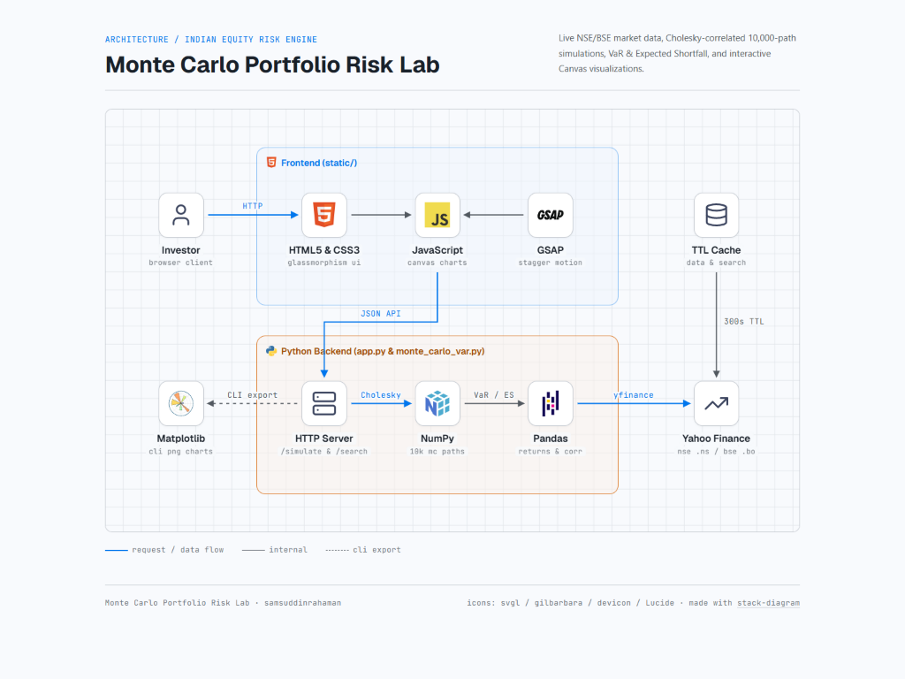

# Indian Equity Monte Carlo Risk Lab (VaR & Expected Shortfall)

An interactive portfolio risk engine and web dashboard for Indian equities (**NSE `.NS` / BSE `.BO`**) powered by live Yahoo Finance data (`yfinance`), Cholesky-correlated Monte Carlo simulations, **Value at Risk (VaR)**, **Expected Shortfall (ES)**, and **correlation stress testing**.

## Features

- **Live Indian Market Data (`yfinance`)**: Downloads >= 2 years of daily adjusted prices and live quotes for NSE (`.NS`) and BSE (`.BO`) stocks, annualizing returns (`× 252`) and volatility (`× √252`).
- **Cholesky Monte Carlo Engine**: Simulates up to 50,000 (default `10,000`) correlated multi-day paths (`Z_corr = Z @ L^T`) over a customizable holding period (default `21` trading days / 1 month).
- **VaR & Expected Shortfall (ES)**: Computes tail loss thresholds and average tail severity in both `%` and `₹ INR` across `90%`, `95%`, and `99%` confidence levels.
- **Correlation Sensitivity & Stress Testing**: Compares **Uncorrelated (No Cholesky)** vs. **Historical** vs. **Stressed Correlation** (`R(α) = (1 - α)R_hist + αJ`) to demonstrate diversification breakdown.
- **Interactive Web Dashboard (`app.py`)**:
  - Searchable **NSE / BSE** stock picker by company name or symbol (`/api/search`), starting clean with no pre-selected stocks.
  - Real-time **Correlation Stress Slider (α)** and **Cholesky Toggle**.
  - Interactive HiDPI Canvas charts (Return Distribution Histogram and Correlation Sensitivity Curve with hover tooltips, plus a centered Active Correlation Matrix Heatmap).
  - Plain-English **Risk Insight** banner and **Outcome Summary** cards explaining what VaR, Expected Shortfall, correlation, and crisis stress mean in ₹ and `%`.
  - Built-in **Help** modal (`<dialog>`) documenting all inputs and quantitative finance terminologies.
- **CLI Mode (`monte_carlo_var.py`)**: Run simulations from the terminal and export `portfolio_risk_analysis.png`.

## Architecture



*(Interactive self-contained diagram: `architecture.html`)*

## Project Structure

```text
montecarlo/
├── .gitignore             # Excludes .venv/, __pycache__/, and generated PNGs
├── LICENSE                # MIT License
├── README.md              # Documentation & usage guide
├── app.py                 # Python HTTP server & JSON API (/api/simulate, /api/search)
├── architecture.html      # Self-contained stack & architecture diagram
├── docs/
│   └── architecture.png   # Rendered architecture diagram for README
├── monte_carlo_var.py     # Core Monte Carlo VaR/ES engine & CLI tool
├── requirements.txt       # Python dependencies
└── static/
    ├── index.html         # Dashboard layout & Help modal
    ├── styles.css         # Dark glassmorphism UI & responsive tables
    └── app.js             # Interactive controls, HiDPI Canvas charts & tooltips
```

## Setup

```bash
git clone <your-repo-url>
cd montecarlo
python -m venv .venv
```

Activate the virtual environment and install dependencies:

- **Windows (PowerShell)**:
  ```powershell
  .\.venv\Scripts\python.exe -m pip install -r requirements.txt
  ```
- **macOS / Linux**:
  ```bash
  source .venv/bin/activate
  pip install -r requirements.txt
  ```

## Usage

### 1. Interactive Web Dashboard

Start the local server:

```powershell
.\.venv\Scripts\python.exe app.py
```

Open `http://127.0.0.1:8000/` in your browser.

### 2. Command-Line Interface (CLI)

Run with the default 5-stock NSE portfolio (`RELIANCE.NS`, `TCS.NS`, `HDFCBANK.NS`, `SUNPHARMA.NS`, `ITC.NS`) and `₹10,00,000` notional value:

```powershell
.\.venv\Scripts\python.exe monte_carlo_var.py
```

Or customize tickers, weights, lookback period, and portfolio value:

```powershell
.\.venv\Scripts\python.exe monte_carlo_var.py \
  --tickers INFY.NS ICICIBANK.NS LT.NS SBIN.NS \
  --weights 0.30 0.30 0.20 0.20 \
  --period 3y \
  --portfolio-value 2500000
```

## Methodology

1. **Historical Parameters**: Daily simple returns are computed from adjusted close prices; mean returns are annualized by `252` and volatilities by `√252`.
2. **Cholesky Decomposition**: Daily standard normal shocks `Z` are correlated via `Z_corr = Z @ L^T` where `L = cholesky(corr_matrix)`, then compounded over the holding horizon (`21` trading days).
3. **Risk Metrics**: Simulated portfolio returns are sorted worst-to-best; `VaR` is the `(1 - confidence)` percentile loss, and `ES` is the mean loss of all paths worse than `VaR`.
4. **Sensitivity Analysis**: Sweeps correlation from `0.0` (uncorrelated, no Cholesky) through historical correlation up to stressed regimes (`α = 0.97`).
